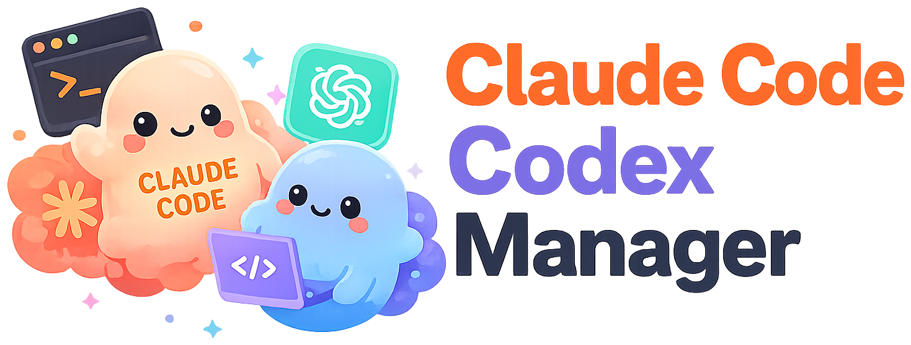

<div align="center">

<picture>
  <source media="(prefers-color-scheme: dark)" srcset="assets/ccc-banner-dark.png">
  
</picture>

# CCC · Claude Code Codex Manager

**One self-contained account switcher and seven-day cost dashboard for Claude Code and Codex — on every machine you use.**

</div>

CCC manages every configured Claude and Codex account, refreshes subscription
usage, switches and re-authenticates accounts, automatically rotates away from
quota limits, and aggregates local usage/cost in its CLI, TUI, JSON API, and
native macOS menu-bar app.

It has no `claude-swap`, `codex-auth`, `ccusage`, Node, Zig, or third-party
Python runtime dependency. Existing registries created by those tools remain
compatible and migrate in place without deleting the source data.

## Features

- Unified Claude and Codex roster with active-account, plan, alias, 5-hour,
  weekly, model-scoped, stale, and login-required states.
- Internal add/remove/import/export/switch/alias/configuration workflows.
- Direct provider usage refresh with token rotation and stale-cache fallback.
- Threshold, hysteresis, cooldown, best-headroom auto-switch for either provider.
- Seven local-calendar-day cost report with combined/provider/account/day/model
  views, token classes, stable event deduplication, and timezone/DST correctness.
- Exact, estimated, partial, and unknown pricing states—unknown prices never
  appear as a misleading `$0`.
- Curses TUI, plain CLI, additive snapshot schema v2, and native SwiftUI menu bar
  chart with accessible loading/empty/error/detail states.
- Multi-machine view: accounts on your other Macs and Linux boxes (over SSH /
  Tailscale), grouped by machine, with online/offline status and per-machine
  switch, disable/enable, re-login, add, and remove.
- Standard-library Python 3.10+ runtime on macOS and Linux.

## Install and upgrade

```sh
# recommended
uv tool install git+https://github.com/michaelvu1207/ccc-manager

# or
pipx install git+https://github.com/michaelvu1207/ccc-manager
```

Upgrade with the same installer:

```sh
uv tool upgrade ccc-manager
# or: pipx upgrade ccc-manager
```

The official `claude` and `codex` CLIs are needed only to use those products
and complete their interactive login flows. CCC itself does not require the old
account switchers or cost utility.

## Usage

Bare `ccc` opens the TUI on a terminal and prints a list when piped.

```sh
ccc list                         # accounts, live quota, cost summary
ccc list --no-refresh            # cached provider quota
ccc monthly                      # internal local-log monthly report
ccc snapshot                     # schema-v2 JSON for front-ends

ccc account add claude           # capture the current Claude login
ccc account add claude --slot 3 --force
ccc account save claude 3        # safely refresh slot 3 from the matching current login
ccc account add codex --auth /path/to/auth.json --alias work
ccc account remove claude 2
ccc account remove codex work

ccc login claude 3               # re-auth slot, restore prior active by default
ccc login codex                   # official Codex login, imported internally
ccc switch claude 2
ccc switch claude --strategy best
ccc switch codex work
ccc alias work client-project
ccc reset codex work --list       # inspect available consumable resets
ccc reset codex work --credit-id ID --confirm

ccc disable 2                    # hold slot 2 out of rotation / auto-switch
ccc enable 2
ccc add-account                  # claude /login, then store the new account

ccc transfer export claude backup.cswap
ccc transfer import claude backup.cswap
ccc transfer export codex auth.json work
ccc transfer import codex auth.json --alias work

ccc config
ccc config set autoswitch.threshold 85
ccc auto --once --dry-run --json claude codex
ccc auto                         # foreground monitor for both providers
```

Claude login capture is identity-checked. After signing in, CCC saves the
current credential only when its email and organization match the requested
slot; it will not overwrite another account. The macOS account row exposes the
same operation with the save icon. Missing credentials and definite provider
authentication rejection are marked as needing login. Rate limits, network
failures, and temporary usage-API errors retain the last verified usage when
available and otherwise show “usage temporarily unavailable” instead of a
false login warning. After signing in, press the save icon for that account;
CCC verifies the identity, stores the fresh credential, and refreshes usage.

Every manual or scheduled refresh also checks the currently active Claude and
Codex login before fetching usage. If its credential changed, CCC saves the new
value to the already-registered account with the same stable provider identity;
an unknown or mismatched identity is never imported or allowed to overwrite a
different account. Refresh then updates usage for every configured account.

For eligible Codex plans, account rows also show the provider-reported number
of consumable usage-limit resets (for example, “3 usage limit resets
available”). The macOS row’s reset button opens a destructive confirmation and,
when several resets are available, lets you select the one to use. CCC never
consumes resets during refresh, switching, or auto-switching. The CLI requires
`--confirm`; it refuses unconfirmed requests before making a network call.

This feature uses the same first-party `wham/rate-limit-reset-credits` workflow
as the Codex desktop app. It is not a documented public API, so CCC keeps it in
an isolated adapter and reports provider errors without retrying consumption.

TUI keys remain `↑`/`↓` (or `k`/`j`), Enter to switch/login, `l` to re-login,
`r` to refresh, and `q` to quit; `d` disables/enables the selected Claude
account and `a` adds a Claude account on the selected machine. Accounts are
grouped by machine.

## Migration and compatibility

CCC reads existing Claude `sequence.json`, config backups, portable `.enc`
credentials, XDG/legacy roots, macOS Keychain entries, and Codex schema 2–4
registries/auth snapshots in place. Unknown registry/config fields survive
CCC writes.

On the first macOS run after upgrading from old `claude-swap` releases, legacy
Keychain ACLs may only permit that old interpreter to decrypt the backups. If
`cswap` is still present, CCC performs a one-time migration through its export
API, writes and verifies copies under the stable system-Keychain service, and
records `.ccc-migrations.json`. It never deletes the old entries. Once migrated,
`cswap` can be uninstalled. If it was removed too early, reinstall it once,
run `ccc list --no-refresh`, verify switching, then remove it again.

Codex registries keep their existing schema and legacy `api`/`auto_switch`
blocks. Structural writes are atomic; import does not overwrite unless
`--force` is supplied. Export files contain plaintext credentials and should be
protected like the provider auth files.

Both console entry points (`ccc` and `cccswitcher`), existing account slots,
emails, organization identities, Codex stable account keys/aliases, XDG cache
locations, and documented commands remain supported.

## Seven-day cost accuracy

“Past seven days” means today plus the previous six dates in the report’s local
timezone. Aware timestamps are converted before bucketing, including DST edges.
Claude request IDs and Codex session cumulative markers deduplicate repeated,
streamed, archived, copied, and subagent observations before any view is summed.

Local logs do not reliably record which subscription account was active for
historical requests. CCC therefore keeps such activity in one `unattributed`
bucket—never copies it into every account—and still lists configured accounts
with zero attributed events. Exact log-provided cost wins. Otherwise the
versioned built-in model table estimates known token classes. Unknown model
prices produce partial/unknown totals with the known lower bound retained.
These are operational estimates, not provider invoices.

Data sources:

- Claude: `${CLAUDE_CONFIG_DIR:-~/.claude}/projects/**/*.jsonl`
- Codex: `${CODEX_HOME:-~/.codex}/{sessions,archived_sessions}/**/*.jsonl`
- Price table: `cccswitcher/pricing.py` (`pricing_version` is emitted in JSON)

## Machines

CCC shows this Mac plus any SSH host you can reach with
`ssh -o BatchMode=yes <alias>` (Tailscale host names work). This Mac always
uses CCC's built-in engine. Remote machines do not need CCC: by default
(`engine: auto` = `cswap`) CCC runs `cswap list --json` (claude-swap ≥ 0.26)
and `codex-auth list` there, with `$HOME/.local/bin` on `PATH`. A remote that
has CCC installed can use `engine: ccc` instead (`ccc snapshot --no-costs`
and `ccc` actions over SSH).

Remote machines are probed in parallel, one SSH round trip each. An
unreachable machine shows as offline with its last known accounts and never
delays the others (`ConnectTimeout=6`; overall `CCC_REMOTE_TIMEOUT`, default
60 s). Two aliases that reach the same host and home directory are detected,
and the second is hidden. CCC never copies credentials between machines and
never reads remote tokens.

The list lives in `~/.config/ccc/machines.json`. Until you edit it, the
default is this Mac plus every host in Starline's connection list.

```sh
ccc machines                          # show the list (id, name, ssh alias, engine)
ccc machines add gpu-box --name "GPU box" [--engine ccc]
ccc machines rename path-pc "Path PC"
ccc machines disable simforge-a100    # keep it listed, stop polling
ccc machines enable simforge-a100
ccc machines engine gpu-box ccc       # auto | ccc | cswap
ccc machines remove gpu-box
ccc machines import-starline          # add hosts new in Starline

ccc list -m path-pc                   # this Mac + one remote
ccc snapshot --machine path-pc        # JSON for one machine (the app uses this)
ccc switch claude 2 --machine path-pc
ccc switch codex a@b.com --machine path-pc
ccc disable 3 --machine path-pc
ccc account remove claude 3 --machine path-pc   # asks first (--yes to skip)
ccc login claude 2 --machine path-pc  # ssh -t: switch, claude /login, switch back
ccc add-account --machine path-pc     # ssh -t: claude /login, then cswap add
```

`ccc snapshot` keeps schema v2 and adds a `machines` array: each entry has
`id`, `alias`, `display_name`, `local`, `engine`, `platform`, `online`,
`error`, `fetched_at`, `stale`, `has_data`, `duplicate_of`, and `providers`.
Accounts gain `alias`, `disabled`, and `status`. On a remote Mac, accounts
other than the active one can show "keychain locked": macOS does not unlock
the login keychain for SSH sessions.

## macOS menu-bar app

The native app renders `ccc snapshot`; it never reads tokens itself. The
Accounts tab groups accounts by machine (collapsible sections with a status
dot and platform icon; offline machines are dimmed with "last seen"). Each
row has a `…` menu: Switch here, Re-login, Disable/Enable, and Remove (with an
inline confirmation). A section's `+` opens Terminal to add an account on that
machine. The server-rack button in the footer opens the Machines screen (add,
rename, remove, pause polling, import from Starline). The Usage tab's compact
chart distinguishes Claude (orange) and Codex (blue), shows today/week totals,
and expands to provider/account/model/token details.

```sh
tools/build_macapp.sh Release
open macapp/build/Build/Products/Release/CCC.app
```

The development build locates `ccc` in common uv/Homebrew paths or through a
login shell. “Start at login” uses `SMAppService`.

## Development and verification

```sh
python3 -m unittest discover -s tests -v
python3 -m compileall -q cccswitcher
python3 -m pip wheel --no-deps .
tools/build_macapp.sh Debug test
```

Provider tests use isolated homes and explicitly disable the real macOS
Keychain. Never put real auth payloads in fixtures or screenshots.

## Security and provenance

Secrets are held only in provider-compatible private files or macOS Keychain,
written atomically with restrictive permissions. Snapshot/cost output contains
no tokens. See [THIRD_PARTY_NOTICES.md](THIRD_PARTY_NOTICES.md) for audited
upstream provenance and retained MIT notices, and
[docs/SELF_CONTAINED_ARCHITECTURE.md](docs/SELF_CONTAINED_ARCHITECTURE.md) for
the architecture, migration, risk critique, and verification plan.

CCC is MIT licensed; see [LICENSE](LICENSE).
